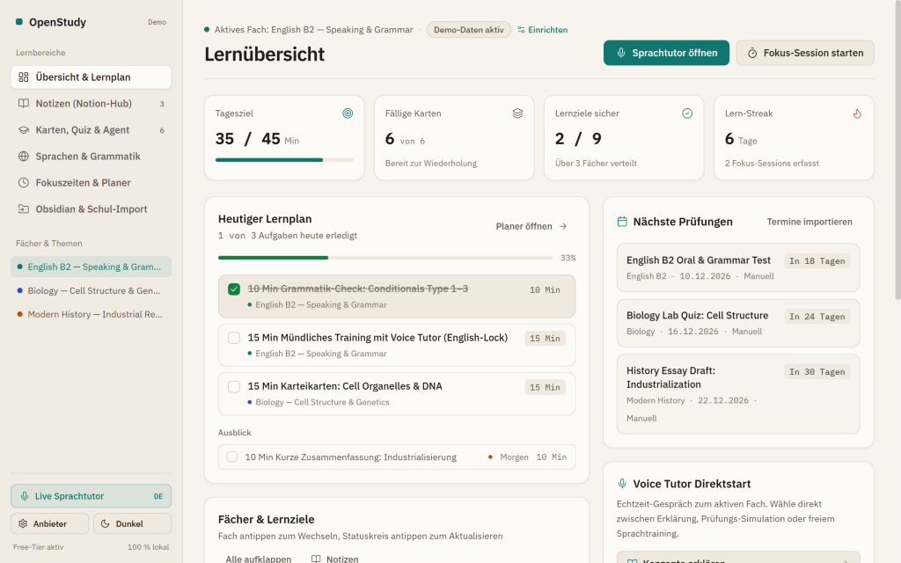
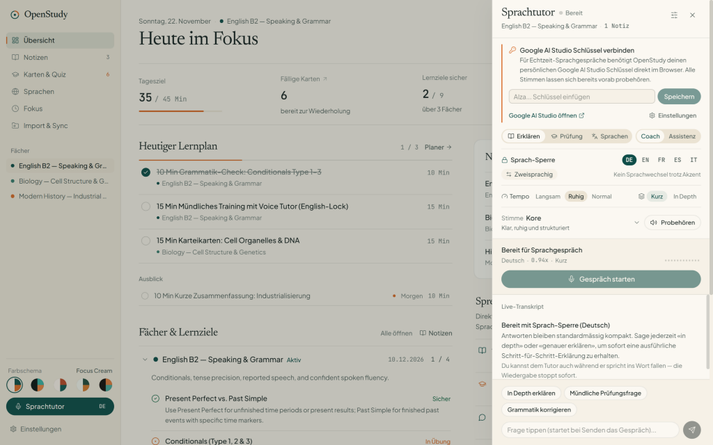
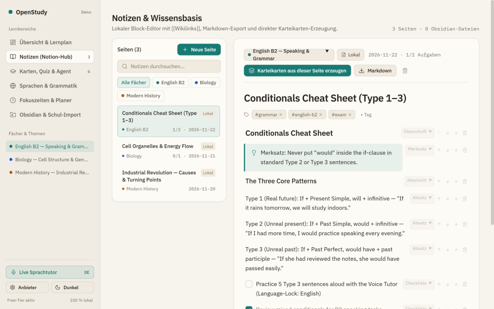

# OpenStudy

**Free, privacy-first, open-source AI learning studio for everyone — calm by design, local by default, and usable with zero technical setup.**

Learn any subject or language with the **Hermes Screen Teacher**, a real-time voice tutor, built-in block notes, direct local Obsidian folder access, a focus planner, daily study plans, and flexible Bring-Your-Own-Provider AI support.

- **Website & Live App:** [simoneggert16-png.github.io/openstudy](https://simoneggert16-png.github.io/openstudy/)
- **Source Code:** [github.com/simoneggert16-png/openstudy](https://github.com/simoneggert16-png/openstudy)

---

## Previews (100% Synthetic Demo Data)

> All screenshots below are rendered exclusively from isolated demo courses (`?mode=demo`) containing zero personal data or credentials.

| Dashboard & Daily Study Plan | Voice Tutor 2.0 (Preview, Pace & Language Lock) |
| :---: | :---: |
|  |  |

| Built-in Notes Studio & Wikilinks | Focus Timer & 5-Language Grammar Studio |
| :---: | :---: |
|  |  |

---

## Key Capabilities

- **Zero-Warning Installable Desktop App (PWA):** Launch OpenStudy directly in the browser and install it as a standalone desktop or mobile app with one click — no unsigned executable downloads, no OS warning dialogs, and no admin privileges required.
- **Five Curated Focus Color Schemes:** Switch live between five warm, low-glare studio palettes designed for long reading and study sessions:
  - `focus-cream` — Warm unbleached paper cream, deep heritage teal, and burnt orange
  - `midnight-teal` — Deep pine night with sea teal and warm ember accents
  - `terracotta-paper` — Warm linen paper, terracotta rust, and deep botanical teal
  - `botanical-sage` — Soft oat paper, forest sage, and warm ochre
  - `espresso-ember` — Dark roast surface with warm copper and calm seafoam teal
- **Simplified, Account-Free Onboarding:** Start learning in seconds without creating an account. Use the built-in notes, flashcards, and focus timer immediately with zero API key, or optionally connect Google AI Studio's free tier or a local Ollama instance.
- **Privacy First & Cost Protection:** Notes, study plans, Obsidian context, and API keys stay strictly on your device (local browser storage / `.env.local`). A built-in **Free-Only Lock** restricts model selection to free tiers and local models by default, and JSON backups automatically strip stored API keys on export.
- **Voice Tutor 2.0:**
  - **Voice Preview:** Audition all six voices (`Kore`, `Zephyr`, `Puck`, `Charon`, `Fenrir`, `Aoede`) before starting a session.
  - **Controllable Speaking Pace:** Choose *Slow*, *Calm*, or *Normal*.
  - **Strict Language Locking:** Practice German, English, French, Spanish, or Italian without language drift, plus an optional bilingual grammar-coach mode.
  - **Adaptive Depth:** Concise 2–4 sentence answers by default, with an on-demand *In Depth* mode for step-by-step explanations.
- **Built-in Notes Studio & Direct Obsidian Vault Access:** Use the local block editor right away, connect any local **Obsidian** vault folder directly from Chrome or Edge without extra software, or import Notion Markdown exports and `.ics` schedules.
- **Coach First, Assistant on Demand:** Defaults to **Coach Mode** (guides you to reason through material yourself) and switches to **Assistant Mode** whenever you want flashcards, study plans, or structured summaries generated directly.
- **Bring Your Own Provider:** Works with Google AI Studio Free Tier, **Nous Research Hermes Agent Gateway**, local **Ollama** (offline, zero key), OpenRouter, Anthropic, OpenAI-compatible endpoints, or local CLI agents (**Antigravity**, **Claude Code**, **OpenAI Codex CLI**) via the optional localhost companion bridge (`bridge/server.mjs`).

---

## Hermes Agent Architecture & Cross-App Screen Teacher

OpenStudy embeds a lightweight **Hermes-inspired autonomous learning agent** designed to teach live across other desktop applications while remembering how you learn best:

- **Cross-App Screen Teacher:** Share any window (Excel, Word, OneNote, PDFs, or an IDE). Hermes inspects the live screen context, walks you through tasks step by step via voice or text, and places numbered visual focus spotlights on formulas, clauses, or controls.
- **Always-on-Top Floating Teacher:** Detach the teacher into a compact, always-on-top **Document Picture-in-Picture** window so guidance stays visible above other desktop programs — with optional native **Windows Desktop Pointer** highlights through the local Companion Bridge (`127.0.0.1:4319`).
- **Autonomous Tool Calling:** During a session, Hermes can execute structured workspace actions on its own — placing screen spotlights, saving study notes, creating spaced-repetition flashcards, adding daily plan tasks, or recording durable learner insights.
- **`SKILL.md` Skills System:** Teach Hermes repeatable workflows (e.g., exam simulation, formula walkthroughs, essay feedback) using editable, toggleable `SKILL.md`-style skill definitions stored locally.
- **Persistent Learner Memory:** Keeps a transparent, user-editable memory of your preferences, strengths, weak spots, and study goals directly in local storage so explanations adapt over time without external cloud profiles.
- **Nous Research Hermes Gateway Compatible:** Connect an existing local **Nous Research Hermes** gateway (`http://127.0.0.1:9119` by default) or the `hermes` CLI via Settings → *KI & Sprache* → *Für Fortgeschrittene*.

---

## Quick Start

### Option 1 — Instant Browser Launch & Desktop App (Recommended)

No downloads, no terminal commands, and no browser security warnings.

1. **Open OpenStudy:** Visit [https://simoneggert16-png.github.io/openstudy/](https://simoneggert16-png.github.io/openstudy/), optionally pick one of the five Focus color schemes, and click **OpenStudy öffnen**.
2. **Install as a Desktop App (10 seconds):**
   - **Chrome / Edge / Brave (Windows, macOS, Linux):** Click the **Install** icon on the right side of the address bar (or use the in-app install prompt). OpenStudy opens in its own dedicated app window with a desktop/dock icon.
   - **Safari (macOS / iPad / iPhone):** Choose **Share → Add to Dock** (macOS) or **Share → Add to Home Screen** (iOS / iPadOS).
3. **Connect Obsidian Directly (Optional):** In Chrome or Edge, open the Notes / Obsidian view inside OpenStudy and select your local Obsidian folder directly — no helper utility needed.

> Tip: Append `?mode=demo&scheme=midnight-teal` (or any of the five scheme IDs) to open the isolated demo workspace directly in a specific palette.

### Option 2 — Run Locally from Source (Developers)

```bash
git clone https://github.com/simoneggert16-png/openstudy.git
cd openstudy
npm install
npm run dev
```

Open `http://127.0.0.1:5175/` (or `http://127.0.0.1:5175/?mode=demo` for the isolated demo workspace).

### Optional Local Companion Bridge (Local CLI Agents, Hermes & Desktop Pointer)

```bash
npm run bridge
```

Runs strictly on `127.0.0.1:4319` (never exposed to the network) to connect local installations of Nous Research Hermes, Antigravity, Claude Code, or Codex CLI, and to power the optional Windows Desktop Pointer overlay during cross-app screen teaching sessions.

---

## Privacy & Security Verification

Before publishing or committing changes, run the built-in privacy and secret scanner:

```bash
npm run privacy-check
```

This checks that zero API keys, zero `.env` files, zero hardcoded user paths, and zero private data folders exist inside tracked repository files.

---

## License

Released under the [MIT License](LICENSE). Built to make calm, private, AI-assisted learning accessible to everyone.
