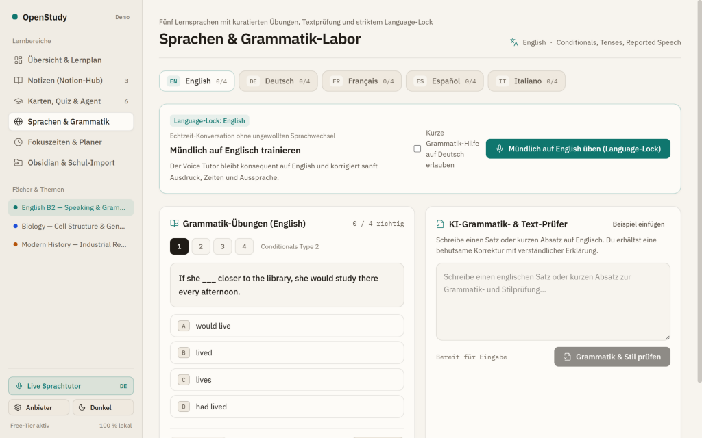

# OpenStudy

**Free, privacy-first, open-source AI learning studio for everyone — regardless of age, budget, or technical experience.**

Learn any subject or language with a calm real-time voice tutor, built-in Notion-style notes, local Obsidian vault context, focus sessions, daily study plans, and flexible Bring-Your-Own-Provider AI support.

---

## Previews (100% Synthetic Demo Data)

> All screenshots below are rendered exclusively from isolated demo courses (`?mode=demo`) containing zero personal data or credentials.

| Dashboard & Daily Study Plan | Voice Tutor 2.0 (Preview, Pace & Language Lock) |
| :---: | :---: |
|  |  |

| Built-in Notion-Style Notes & Wikilinks | Focus Timer & 5-Language Grammar Studio |
| :---: | :---: |
|  |  |

---

## Why OpenStudy?

- **100% Free to Use:** Works out of the box with Google AI Studio's **Free Tier** (`gemini-3.8-live` for real-time speech & `gemini-3.8-flash` for text) or completely offline with **Ollama** (0 cost, zero API key). A built-in **Free-Only Lock** prevents accidental paid API usage.
- **Privacy First — Your Data Stays Yours:** Notes, study plans, Obsidian context, and API keys stay strictly on your device (`.env.local` / local browser storage). Nothing is uploaded to any OpenStudy server.
- **Simple Universal Installer:** Download and run a single installer — no terminal knowledge required. Includes an optional 1-click checkbox to install **Obsidian** and set up your study vault automatically.
- **Voice Tutor 2.0:**
  - **Voice Preview:** Hear every voice (`Kore`, `Zephyr`, `Puck`, `Charon`, `Fenrir`, `Aoede`) before starting a conversation.
  - **Calm, Controllable Speaking Pace:** Choose *Slow*, *Calm*, or *Normal*.
  - **Strict Language Locking:** Practice German, English, French, Spanish, or Italian without the model drifting into other languages — plus an optional bilingual grammar-coach mode.
  - **Adaptive Depth:** Concise 2–4 sentence replies by default; say *"explain in depth"* (or toggle *In Depth*) whenever you want a deep step-by-step walkthrough.
- **Built-in Knowledge Hub + Obsidian & Notion:** Use the local block-based Notion alternative immediately, connect any local **Obsidian** vault folder for personal context, or import Notion Markdown exports and school `.ics` calendars / syllabus sheets cleanly.
- **Coach First, Assistant on Demand:** The integrated study agent defaults to **Coach Mode** (guides you to understand concepts yourself) and can be switched to **Assistant Mode** whenever you want flashcards, study plans, or structured summaries generated directly.
- **Bring Your Own Provider (Power Users):** Plug in Google Free Tier, Ollama (local), OpenRouter, Anthropic, OpenAI-compatible endpoints, or connect existing local installations of **Antigravity**, **Claude Code**, or **OpenAI Codex CLI** via the optional localhost companion bridge (`bridge/server.mjs`).

---

## Quick Start (Zero Technical Knowledge)

### Option 1 — Universal 1-Click Installer
- **Windows:** Download & run [`installer/windows/OpenStudy-Setup.exe`](installer/windows/OpenStudy-Setup.exe) (optional checkboxes for automatic Obsidian & Ollama setup).
- **macOS:** Double-click [`installer/macos/Install-OpenStudy.command`](installer/macos/Install-OpenStudy.command).
- **Linux:** Run [`installer/linux/install-openstudy.sh`](installer/linux/install-openstudy.sh).

### Option 2 — Developer Setup
```bash
git clone https://github.com/simoneggert16-png/openstudy.git
cd openstudy
npm install
npm run dev
```

Open `http://127.0.0.1:5175/` (or `http://127.0.0.1:5175/?mode=demo` for the isolated demo workspace).

### Optional Local Companion Bridge (Obsidian Sync, Daily Reminders & Local CLI Agents)
```bash
npm run bridge
```
Runs strictly on `127.0.0.1:4319` (never exposed to the network).

---

## Privacy & Security Verification

Before publishing or committing changes, run the built-in privacy & secret scanner:
```bash
npm run privacy-check
```
This verifies that zero API keys, zero `.env` files, zero local machine paths, and zero private data folders exist inside tracked repository files.

---

## License

Released under the [MIT License](LICENSE). Built to make high-quality, private AI-assisted learning accessible to everyone.
